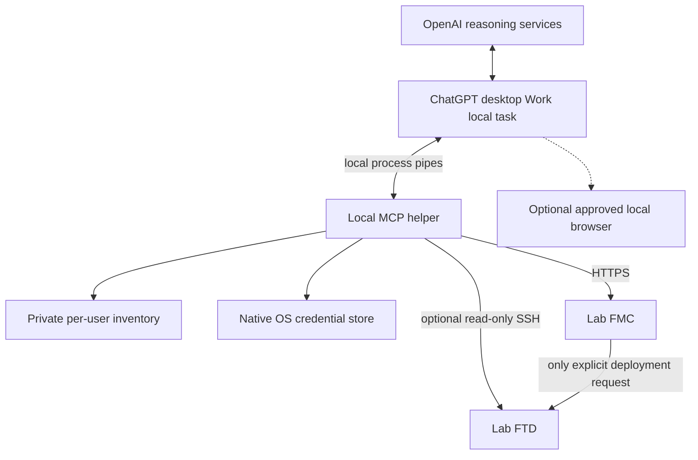

# Architecture and limits

ChatGPT Work loads a reusable skill and launches a local Python MCP helper over
stdio. The helper reaches FMC HTTPS and optional FTD SSH from the user's machine.
There is no listener, public service, inbound network port, jump host, or tunnel.
The installed launch entry uses a durable prepared release so the desktop's
plugin cache does not need to contain a portable virtual environment.

## What is verified by documentation

- [Plugins](https://learn.chatgpt.com/docs/plugins) explicitly work in Work and
  can combine skills and MCP servers.
- [Desktop-only plugins](https://developers.openai.com/plugins/deploy/desktop-only)
  can start local stdio processes. They require locally running threads. Public
  directory submission of local MCP plugins currently needs partner approval;
  private local marketplace distribution is the chosen route here.
- [Plugin packaging](https://developers.openai.com/plugins/build/plugins)
  documents personal/repository marketplaces in desktop Work and root portable
  manifests. A schema attachment does not itself implement an authenticated API
  integration; this helper provides that execution layer.
- [Workspace plugin management](https://learn.chatgpt.com/docs/enterprise/plugin-management)
  supports private GitHub import/sync, revisions, and role policies. Packages
  declaring MCP servers are desktop-only. This build does not create a workspace
  marketplace or claim account entitlement.
- [Work local security](https://learn.chatgpt.com/docs/enterprise/chatgpt-work-local-security)
  explains that local execution can still send relevant context/results to
  OpenAI. Cloud-only execution does not inherit private-machine network access.

Use local Work for this release. Work Cloud's optional connected-computer
capabilities are not a promise that this local plugin will run in a cloud-only
conversation or when the computer is unavailable. No plugin hooks are used;
configuration/deployment checks live in the service itself.

If a workspace blocks local plugins, obtain access through its administrator.
A different architecture could use an authenticated remote HTTPS MCP app and
per-user outbound local agents to reach private labs while retaining local
credentials. That requires additional hosting, app registration, user-to-agent
authorization, and policy review; it is not implemented or claimed as an automatic
fallback. A cloud connector cannot simply reach a user's `localhost`.

## Credentials and transport

The helper explicitly chooses the macOS or Windows keyring backend. Inventory
contains usernames and credential references, not passwords. Native stores
remain under the local user's permissions. The helper has no tool for returning
a password. Sensitive body fields accept local `$secret` references; authentication
values are injected internally. Logs and evidence redact known secret values,
sensitive keys, relevant field/value metadata, and private-key blocks.

FMC authentication follows [Cisco's token protocol](https://www.cisco.com/c/en/us/td/docs/security/firepower/10-0/API/REST/firepower_management_center_rest_api_quick_start_guide_10_0/Connecting_With_A_Client.pdf).
Tokens live in process memory, refresh proactively, and are regenerated after
the documented refresh allowance. Read requests may retry bounded transient
failures. Writes are not automatically replayed after errors or uncertain results.
Device roles remain the ultimate authorization boundary.

HTTPS certificate and hostname verification are mandatory, with optional enrolled
CA bundles. Proxy environment variables are not inherited by the FMC HTTP client.
Only inventory origins and catalog paths are used; redirects and remote pagination
links are not followed. OpenAPI references cannot retrieve remote URLs/files.

## Configuration versus deployment

All schema operations are discoverable. Reads and ordinary configuration
namespaces are executable. `/operational/`, deployment, dynamic mappings/overrides,
and unreviewed write namespaces are blocked in the general configuration tool.
The conservative classification is a v1 execution boundary, not a semantic proof
of every Cisco feature's runtime effects. Some saved configuration can take
effect immediately even without a conventional deployment.

Deployment requires its separate tool, exact device UUIDs, an explicit current
scope summary, and a five-minute single-use preview. The preview includes all
pending changes on selected devices; selective deployment is not implemented.
The helper rechecks readiness, common version, and pending-change digest, and
never sets force or warning bypass. Device-version checks provide another server
guard; external FMC clients can still race with a request, and FMC must enforce
its own transaction/version semantics.

The `authorization_request` argument is supplied by the model. The service
checks its presence, not the authenticity of human intent. The skill enforces
the natural-language policy; host approvals and FMC RBAC are independent. This
is not an unbypassable signed-user-consent system. Required application or
workspace approvals cannot be suppressed by the package.

Evidence distinguishes HTTP acceptance, saved-state read-back, async task
completion, and runtime observation. Failed read-back never authorizes retrying
a write blindly. No universal atomic transaction or automatic rollback is claimed.
Mutations on the same alias serialize locally; different aliases for the same
FMC or other clients need FMC's own concurrency controls.

## Optional browser and SSH

[Computer Use](https://learn.chatgpt.com/docs/computer-use) is documented for
Work on supported macOS/Windows clients and regions. It needs its own plugin,
permissions, and app approvals. macOS requires Screen Recording/Accessibility;
Windows operates the active desktop. It cannot automate terminal apps or
approve OS security prompts. Browser sessions and REST tokens are separate.
No browser automation or automatic browser password injection is included here.

SSH diagnostics have a small read-only allowlist, verified host keys, bounded
output, and recognized prompts. No expert mode, configuration, or privilege
escalation. These prompt/command assumptions require live FTD validation.
